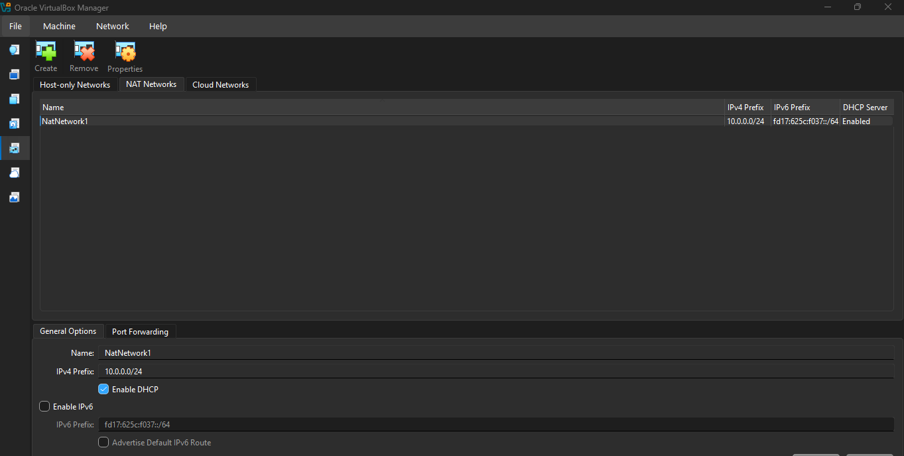
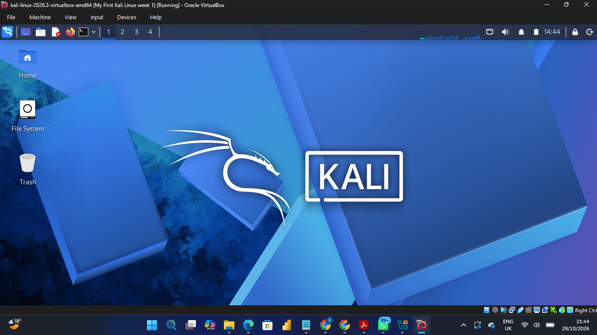
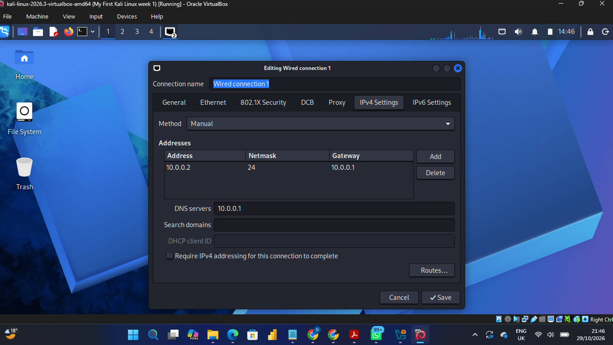

# NETWORKWALKS-Djama-B084-WK1-PM1-CYBERSECURITY-LAB-SETUP
First week project 
This project focuses on setting up a **virtual cybersecurity and penetration-testing laboratory** using VirtualBox and Kali Linux.

The purpose of the lab is to create a learn and practice using virtual environment within 4 week given time .
For the first week lab we do need to : VirutalBox and Kali linux . 
# STEP ONE Installing Virtual Box and Configuring Network setting 

# Step TWO Installing Kali Linux

#Step Three Kali Linux Network Configuration

